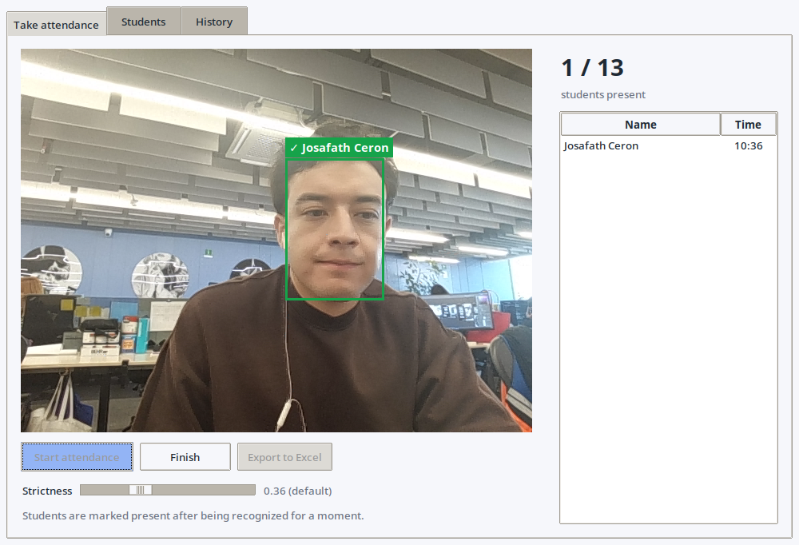
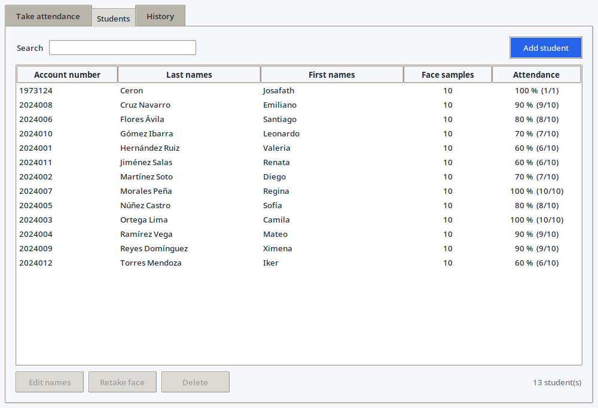
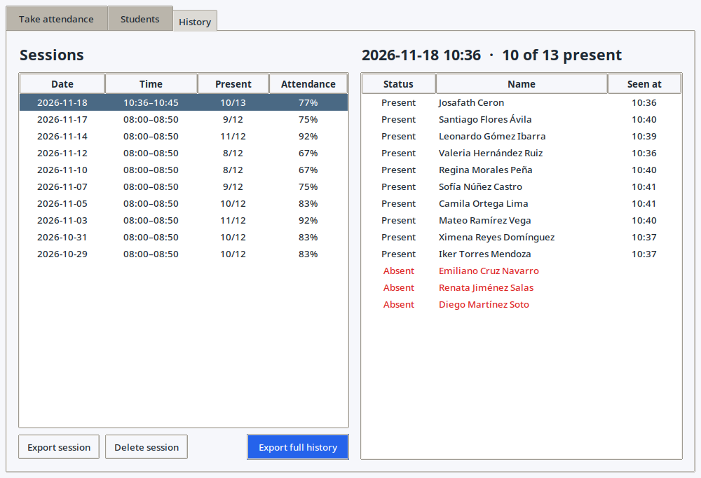

# Attendance Management

[](https://github.com/Josafath/attendance-management/actions/workflows/v2-tests.yml)


A desktop app that takes class attendance with **face recognition**. Register each student once with the webcam, then point the camera at the class: the app recognizes who is there, marks them present and exports the list to Excel.



 

<sub>Screenshots of v2 with demo data: apart from the author, the students are fictional.</sub>

The project exists in two versions, written years apart. Both are kept so the difference is visible:

| | [v1](v1/) (2021) | [v2](v2/) RollCall |
|---|---|---|
| **Face detection** | Haar cascade | **YuNet** neural network: finds turned faces, glasses, low light |
| **Recognition** | LBPH, one frame is enough | **SFace** embeddings + cosine similarity, confirmed over **5 of 8 frames** |
| **What's stored** | 20 photos of each face | **128 numbers per sample, no photos** |
| **Attendance** | Students present | **Present and absent**, session history, % per student |
| **Students** | Add only | Search, edit, retake face, delete (with all their face data) |
| **Interface** | Separate OpenCV windows | One window: live camera, names drawn on faces, live list |
| **Excel** | One list per day (via `xlsxwriter`) | One session or full history, written with the **standard library** |
| **Dependencies** | 4 packages (opencv-contrib, NumPy, Pillow, xlsxwriter) | **OpenCV + NumPy** only |
| **Tests** | None | **143 tests**, CI on Windows, macOS and Linux |

📐 **[Architecture, algorithms and technical details](v2/docs/ARCHITECTURE.md)**: layers, data model, how a frame becomes a name, threading, the Excel writer, privacy, testing strategy and known limitations.

---

## v2: RollCall

### How it works

1. **First run:** the two face models (about 38 MB) are downloaded from OpenCV's official model zoo and verified with SHA-256.
2. **Students → Add student:** type the account number and name, then look at the camera. It collects 10 slightly different samples of the face and warns if that face already belongs to another student.
3. **Take attendance → Start:** each face gets a box. **Green** = present, **amber** = being confirmed, **red** = unknown. The list of present students fills up on the right.
4. **Finish → Export to Excel.** The **History** tab shows every session and exports one or all of them.

If the app is closed during a session, the next start offers to continue it.

### How recognition works, in short

```
camera frame → YuNet finds faces → align each face → SFace: 128 numbers
             → compare with every student (cosine similarity ≥ 0.363)
             → present after 5 of the last 8 frames
```

Each face becomes a vector of 128 numbers. Two photos of the same person point in a similar direction, so their similarity (the dot product of the normalized vectors) is high. On OpenCV's sample photos, the same person scored **at least 0.78** and two different people **at most 0.25**; the default threshold is 0.363. The full explanation, with diagrams, is in [ARCHITECTURE.md](v2/docs/ARCHITECTURE.md#4-from-a-camera-frame-to-a-name).

### Install and run

You need **Python 3.10 or newer** with Tkinter, and a webcam.

| System | Get Python with Tkinter |
|---|---|
| Windows | Install from [python.org](https://www.python.org/downloads/). Keep **"tcl/tk and IDLE"** ticked and tick **"Add python.exe to PATH"**. |
| macOS | Install from [python.org](https://www.python.org/downloads/), which includes Tk, or with Homebrew: `brew install python python-tk`. |
| Linux | `sudo apt install python3-tk python3-venv` (Debian/Ubuntu). On Ubuntu 24.04 the venv package is `python3.12-venv`. |

Windows (PowerShell):

```powershell
cd v2
py -m venv .venv
.venv\Scripts\activate
pip install -r requirements.txt
python -m rollcall
```

macOS / Linux:

```bash
cd v2
python3 -m venv .venv
source .venv/bin/activate
pip install -r requirements.txt
python -m rollcall
```

To use another camera (an external webcam is often number 1, or 2 on Linux), set `ROLLCALL_CAMERA`:

```bash
ROLLCALL_CAMERA=1 python -m rollcall          # macOS / Linux
$env:ROLLCALL_CAMERA=1; python -m rollcall    # Windows PowerShell
```

On macOS, the first time, allow the Terminal to use the camera (System Settings → Privacy & Security → Camera).

### Where the data is

| System | Folder |
|---|---|
| Windows | `%APPDATA%\RollCall` |
| macOS | `~/Library/Application Support/RollCall` |
| Linux | `~/.local/share/rollcall` |

It holds the database (`rollcall.db`) and the models. Set `ROLLCALL_DATA_DIR` to use another folder, for example on a USB drive. Excel exports go wherever you choose (Downloads by default).

### Privacy

- **No photos are stored**, only face embeddings (128 numbers per sample). They are still biometric data: keep the data folder private.
- **Deleting a student deletes all their face data** and attendance history.
- The data folder is **outside the project**, so it can't be committed to git by accident.

### Tests

```bash
cd v2
pip install -r requirements-dev.txt
python -m pytest
```

The tests use a fake camera and a fake face engine, so they run in seconds without a webcam. The end-to-end tests with the real models run when `ROLLCALL_TEST_ASSETS` points to a folder with the two `.onnx` models and OpenCV's sample photos `messi5.jpg` and `lena.jpg` (GitHub Actions downloads and caches them).

### Project structure

```
v2/
  rollcall/
    database.py       students, face embeddings, sessions, attendance (SQLite)
    faces.py          YuNet detection + SFace embeddings
    recognition.py    matching, confirmation over frames, enrollment
    attendance.py     use case: one attendance session
    registration.py   use case: register or retake a face
    export.py         what goes in each Excel file
    xlsx.py           .xlsx writer using only the standard library
    worker.py         camera + recognition in a background thread
    models.py         downloads and verifies the models
    camera.py, paths.py
    ui/               Tkinter: setup, attendance, students, history, dialogs
  tests/              143 tests
  docs/ARCHITECTURE.md
```

### Known limitations

- **No liveness detection:** a photo of a registered student held up to the camera can be recognized. With a teacher in the room it's a minor risk; see [ARCHITECTURE.md](v2/docs/ARCHITECTURE.md#12-known-limitations) for this and the others.
- A student marked by mistake can't be unmarked from the window yet.

---

## v1: the original version (2021)

https://user-images.githubusercontent.com/29525443/138616417-8d70ac92-34df-43eb-8a17-ccb4489c6d92.mp4

`v1/` is the original app with only its bugs fixed: Tkinter + OpenCV's Haar cascade and LBPH recognizer, photos stored on disk, and the list exported with `xlsxwriter`. Run it from `v1/`:

```bash
cd v1
pip install -r requirements.txt   # uses opencv-contrib-python
python main.py
```

<details>
<summary><b>Bugs fixed in v1</b></summary>

- **With two or more students, the attendance list was empty.** The ids were joined into one text (`IN ('1,2,3')`), so the query only matched when exactly one student was recognized. Now each id is a query parameter.
- **Strangers were marked present.** Any face with an LBPH distance under 100 was accepted. The limit is now 70.
- **It only ran inside the IDE.** The imports mixed `App` and `src.Recognition_files`, and the file paths depended on the working folder.
- **Saving the Excel file crashed** on systems without a `~/Downloads` folder (on a Spanish Linux it's `~/Descargas`).
- **New students weren't recognized** unless you pressed "<- Back", the only place where the model was trained.
- **Training lost pictures:** it ran the face detector again on already-cropped faces.
- **Taking attendance before registering anyone** crashed.
- **Registering** crashed with an empty, non-numeric or duplicate account number, and saved the student even if the camera failed.
- With two people in front of the camera during registration, **both faces were saved with the same id**.
- The results table **kept adding rows** on every attendance and stayed visible on other screens.
- A second attendance on the same day **overwrote** the first Excel file.
- `.gitignore` didn't exclude the face pictures, the model or the database.

</details>

v1 stores **photos of faces** in `v1/Recognition_files/dataset/`. They are in `.gitignore` and must never be uploaded.

## License

[MIT](LICENSE)
