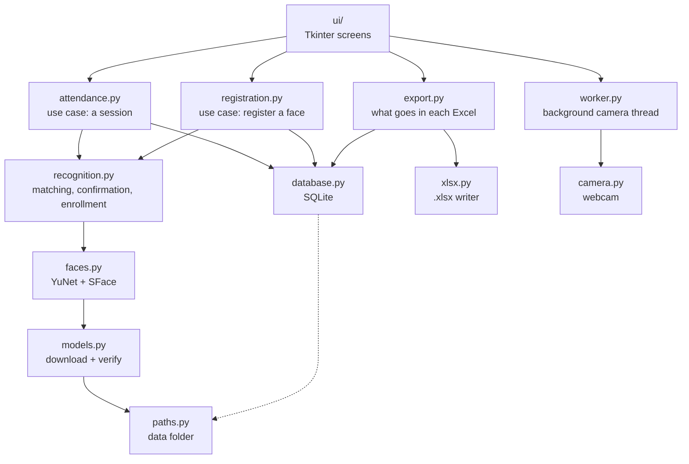
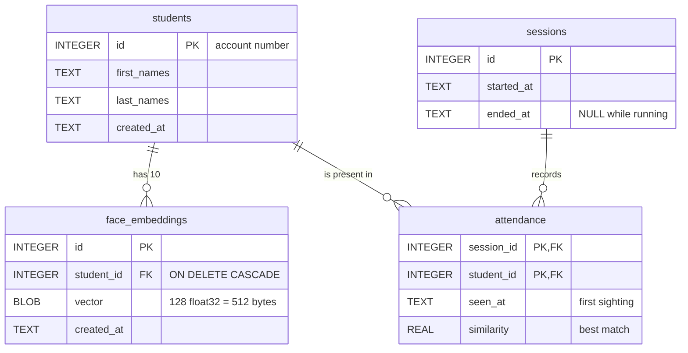
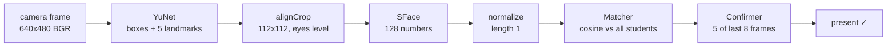
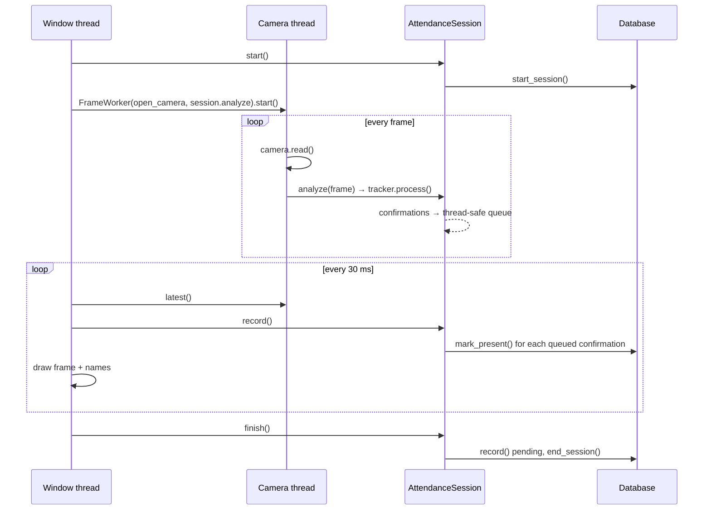

# RollCall: architecture, algorithms and technical details

This document explains how RollCall (v2) is built and why. The [README](../../README.md) covers installing and using it.

**Contents**

1. [Goals](#1-goals)
2. [Architecture](#2-architecture)
3. [Data model](#3-data-model)
4. [From a camera frame to a name](#4-from-a-camera-frame-to-a-name)
5. [Taking attendance](#5-taking-attendance)
6. [Registering a student](#6-registering-a-student)
7. [Threads: a camera that never freezes the window](#7-threads-a-camera-that-never-freezes-the-window)
8. [Excel export without a library](#8-excel-export-without-a-library)
9. [Privacy and security](#9-privacy-and-security)
10. [Testing strategy](#10-testing-strategy)
11. [Design decisions](#11-design-decisions)
12. [Known limitations](#12-known-limitations)

---

## 1. Goals

v1 (2021) answered "who came today?" and had serious bugs: with two or more students in class the list came out empty, and strangers were marked present. v2 is a rewrite with these goals:

| Goal | How |
|---|---|
| **Reliable recognition** | Neural networks (YuNet + SFace) instead of Haar cascades + LBPH; a student is marked present only after several sightings |
| **Complete attendance** | Present *and* absent students, session history, attendance percentage per student, Excel export |
| **Privacy** | Face *embeddings* are stored, not photos; deleting a student deletes all their face data |
| **Few dependencies** | Only OpenCV and NumPy. The UI, database and Excel export use Python's standard library |
| **Testable** | No logic depends on a real camera, window or model: 143 tests, most of them run in milliseconds |

## 2. Architecture

### 2.1 Layers

Each layer only uses the layers below it. The UI is a thin shell over the use cases.



| Layer | Modules | Knows about |
|---|---|---|
| Interface | `ui/` | Tkinter. Draws, asks, and calls the use cases |
| Use cases | `attendance`, `registration`, `export` | The rules: one open session at a time, validate before the camera starts, what an export contains |
| Logic | `recognition`, `xlsx` | Pure computation: receives data, returns data. No files, no camera, no database |
| Infrastructure | `database`, `faces`, `camera`, `models`, `paths`, `worker` | SQLite, OpenCV, the webcam, the network, the file system, threads |

### 2.2 Dependency injection

Nothing creates the things it depends on. `App` receives the database, a function that opens the camera and a function that builds the face engine; `AttendanceSession` receives the database and the engine; `Database` receives a clock. `main()` passes the real ones, and the tests pass fakes:

| Real | Fake used in tests |
|---|---|
| `Webcam` | a camera returning prepared frames |
| `OpenCVFaceEngine` (neural networks) | `FakeEngine`: returns chosen embeddings instantly |
| `datetime.now` | `FakeClock`, moved by hand |
| the user's data folder | a temporary folder per test (`ROLLCALL_DATA_DIR`) |

### 2.3 Modules

| Module | Responsibility | Main types |
|---|---|---|
| `paths.py` | Where data lives (per OS), overridable with `ROLLCALL_DATA_DIR` | `data_dir`, `database_file`, `models_dir`, `exports_dir` |
| `database.py` | All reads and writes | `Database`, `Student`, `Session`, `ReportRow`, `StudentStats` |
| `models.py` | Downloads the models once and checks their SHA-256 | `Model`, `ensure_models`, `DownloadError` |
| `camera.py` | The `Camera` protocol and the real webcam | `Camera`, `Webcam`, `CameraError` |
| `faces.py` | Detection and embeddings | `Face`, `FaceEngine`, `OpenCVFaceEngine` |
| `recognition.py` | Matching, confirmation, enrollment | `Matcher`, `Confirmer`, `AttendanceTracker`, `Enroller` |
| `attendance.py` | One attendance session | `AttendanceSession`, `RecognitionSettings` |
| `registration.py` | Registering or retaking a face | `Registration` |
| `worker.py` | Camera + analysis in a background thread | `FrameWorker` |
| `export.py` / `xlsx.py` | Excel files | `session_workbook`, `history_workbook`, `Workbook` |
| `ui/` | Setup, three tabs, two dialogs, video widget | `App`, `AttendanceTab`, `StudentsTab`, `HistoryTab`, `RegisterDialog` |

## 3. Data model



Decisions worth explaining:

- **Absent students are computed, not stored.** A student is *enrolled* in a session if they registered before it started. Absent = enrolled with no attendance row. So a student who joins in March isn't "absent" from January's sessions, and their percentage only counts sessions since they joined.
- **"No data" is not 0 %.** A student with no sessions yet has percentage `None` (an empty cell in Excel), not 0 %.
- **Marking present twice is harmless.** The primary key `(session_id, student_id)` plus an *upsert* keeps the first time seen and the best similarity.
- **Deleting cascades.** `PRAGMA foreign_keys = ON` and `ON DELETE CASCADE`: deleting a student removes their embeddings and attendance in the same statement.
- **Schema version.** `PRAGMA user_version` stores the schema version; a database from a newer RollCall is refused instead of being damaged.
- **Names sort like people expect.** A custom SQLite collation (`COLLATE NAME`) ignores accents and capitals using `unicodedata`: Ávila, Diaz, lopez, Lozano, Ñúñez, Ruiz.
- **Atomic registration.** A student and their embeddings are inserted in one transaction: a student can't exist without a face because of a crash halfway.

## 4. From a camera frame to a name



### 4.1 Detection: YuNet

YuNet is a small (230 KB) convolutional network that returns, for each face, a box, a confidence score and five landmarks: both eyes, the nose tip and both mouth corners. Faces with a score below 0.8 are ignored. Unlike the Haar cascade in v1, it finds faces turned to the side, with glasses or in poor light.

### 4.2 Alignment

`alignCrop` uses the landmarks to rotate and scale every face to the same 112×112 picture with the eyes in fixed positions. Without this, the same face tilted 10° would produce a noticeably different embedding.

### 4.3 Embedding: SFace

SFace (37 MB) turns the aligned face into a vector of 128 numbers. It was trained so that photos of the same person produce vectors pointing in a similar direction, and different people point in different directions. The vector is then normalized to length 1.

### 4.4 Comparing faces: cosine similarity

For two vectors of length 1, the cosine of the angle between them is just their dot product:

```
similarity(a, b) = a · b = a₁b₁ + a₂b₂ + … + a₁₂₈b₁₂₈      (from -1 to 1)
```

OpenCV's recommended threshold for SFace is **0.363**: above it, the two faces are taken as the same person. Measured on OpenCV's sample photos (20 variants of each: mirrored, rotated ±8°, darker, brighter):

| Pair | Similarity |
|---|---|
| Same person, different variants | min **0.78**, mean 0.88 |
| Two different people | max **0.25**, mean 0.15 |

### 4.5 The Matcher: one face against every student

Each student has 10 embeddings. All embeddings are stacked in one matrix, so comparing a face with *every* embedding is a single matrix-vector product:

```python
similarities = matrix @ face            # (n_embeddings × 128) · (128,) → (n_embeddings,)
best = np.full(n_students, -1.0)
np.maximum.at(best, owner, similarities) # best similarity per student, no Python loop
```

`owner[i]` is the student of row `i` (from `np.unique(..., return_inverse=True)`). A face's score for a student is its **best** similarity with any of that student's embeddings: one good angle is enough.

### 4.6 One face, one student

When two faces in the same frame both look like the same student (twins, or a photo of a student held up next to them), the tracker assigns students greedily, best similarity first: each student goes to at most one face and each face to at most one student. The other face is "Unknown".

### 4.7 The Confirmer: no lucky frames

v1 marked a student present after **one** frame, the main source of its false positives. v2 requires a student to be recognized in **5 of the last 8 frames**:

```
frame:      1  2  3  4  5  6  7  8
seen Ana?   ✓  ✓  ✗  ✓  ✗  ✓  ✓        → 5 of the last 8 → confirmed at frame 7
```

A sliding window instead of "5 in a row" tolerates a blink or a head turn without starting over. Each student is confirmed once per session; the best similarity seen is stored.

Faces smaller than 40 px are ignored: they're far away, and too few pixels give unreliable embeddings.

## 5. Taking attendance

`AttendanceSession` is the use case. Its rules:

- **One open session at a time.** Starting a second one fails with a clear message.
- **Can be resumed.** If the app closes during a session, the session stays open; on the next start the app offers to continue it, and students already marked are not marked twice.
- **No empty sessions.** With no registered faces, the session isn't created at all.
- **The threshold can change while running** (the "Strictness" slider), validated to 0–1.
- **`with AttendanceSession.start(...)`** always closes the session, even if the camera fails.



## 6. Registering a student

1. **Validate first.** The account number, names and "not already registered" are checked *before* the camera turns on, so nobody poses for nothing.
2. **Collect 10 varied samples.** A frame is used only if it has exactly one face (v1 saved two people under one id), at least 80 px, with a detection score ≥ 0.9. One frame in three is looked at (~10 per second).
3. **Variety on purpose.** A sample is kept only if its similarity to every kept sample is below 0.97. Ten copies of the same pose recognize worse than ten slightly different ones, so the hint asks to "move your head a little".
4. **Duplicate check.** The average of the new embeddings is compared with every registered student. If it matches someone, the app asks before saving (the same person registered twice under two numbers). When retaking a face, the student's own embeddings are excluded.
5. **Atomic save.** Student + embeddings in one transaction.

## 7. Threads: a camera that never freezes the window

Recognition takes 20–40 ms per frame. Running it in Tkinter's thread would freeze the window, so it runs in a background thread. Three constraints shape the design:

| Constraint | Consequence |
|---|---|
| Tkinter widgets may only be touched from Tkinter's thread | The worker never calls the window. The window *polls* the worker with `after(30)` (`WorkerPoller`) |
| A SQLite connection may only be used by the thread that created it | `analyze()` (worker thread) never touches the database; `record()` (window thread) does |
| The window may be slower than the camera | The worker keeps only the **newest** frame; older ones are dropped so the video never lags |

Dropping frames created a subtle bug, found by the UI tests: a student confirmed in a dropped frame was never saved. The fix: confirmations don't travel inside the frame result, they go through a `queue.SimpleQueue`, which loses nothing. `finish()` also drains the queue, so a confirmation in the very last frame is saved.

A second subtlety: Python's garbage collector runs in whichever thread is allocating memory, often the camera thread. If it frees a closed Tk window there, Tkinter is called from the wrong thread. `WorkerPoller` runs `gc.collect()` from Tkinter's thread when the camera starts and every ~2 seconds, so Tk objects are always freed in their own thread.

**Showing video without Pillow.** Tkinter's `PhotoImage` reads the PPM format: a short header (`P6 640 480 255`) followed by the RGB bytes. Converting an OpenCV frame is reversing the channel order (BGR → RGB) and adding the header; showing a 640×480 frame takes about 16 ms. Names are drawn on the Canvas, not on the image, because Tk fonts handle accents (José, Peña) and OpenCV's `putText` only draws ASCII.

## 8. Excel export without a library

An `.xlsx` file is a ZIP archive of XML files. `xlsx.py` writes only what the app needs, with `zipfile` and `xml.sax.saxutils`:

```
[Content_Types].xml           what each part is
_rels/.rels                   where the workbook is
xl/workbook.xml               the sheets
xl/_rels/workbook.xml.rels    where each sheet and the styles are
xl/styles.xml                 bold font, date and percent formats
xl/worksheets/sheetN.xml      the cells
```

- **Dates are real dates**: days since 1899-12-30 (Excel's epoch, inherited from Lotus 1-2-3), with a `yyyy-mm-dd hh:mm` format, so they sort and filter correctly.
- **Text is always text** (`inlineStr`), never a formula: a name like `=HYPERLINK(...)` can't run anything. This is a known risk of CSV exports, which also open in one column in Excel set to Spanish (where the separator is `;`).
- **Control characters are removed** (illegal in XML), quotes in sheet names are escaped, and sheet names follow Excel's rules (≤ 31 characters, no `[]:*?/\`, unique ignoring case).
- **Atomic save**: written to a temporary file and renamed, so a failure never leaves a broken `.xlsx`.
- **Separation of concerns**: `export.py` decides *what* goes in each file (it knows about students); `xlsx.py` decides *how* it's written (it knows nothing about students). The output was checked by opening it with LibreOffice.

Exports:

| File | Sheets |
|---|---|
| One session | Attendance: start/end, "X of Y present", then present students (time seen, similarity) and absent ones |
| Full history | **Students** (attended / sessions / %), **Sessions** (present / enrolled / %), **By session** (a P/A grid, empty where the student hadn't registered yet) |

## 9. Privacy and security

- **Embeddings, not photos.** No face image is ever written to disk. An embedding is 128 numbers; it's still biometric data and is treated as such.
- **Data outside the project folder**: `%APPDATA%\RollCall`, `~/Library/Application Support/RollCall` or `~/.local/share/rollcall`. It can't be committed to git by accident.
- **Deletion is complete**: deleting a student deletes their embeddings and attendance (cascade).
- **Verified models**: each model is downloaded to a `.part` file, its SHA-256 compared with a pinned value, and only then renamed into place. A tampered or truncated download is discarded.
- **SQL parameters everywhere**: no value is ever pasted into a query (v1's main bug came from that). `LIKE` wildcards in searches are escaped.
- **No formulas in exports** (see §8).

## 10. Testing strategy

143 tests in `v2/tests/`. Most run in milliseconds, without a camera or the neural networks.

| File | Tests | What it proves |
|---|---|---|
| `test_database.py` | 37 | Validation, duplicates, accent-insensitive sorting, search with `%` and `_`, embeddings stored exactly, invalid embeddings rejected all-or-nothing, cascade delete, present/absent rules, students who joined later, percentages, schema version |
| `test_recognition.py` | 26 | Best-of-each-student matching, threshold, confirmation window with gaps, one face per student, far faces skipped, live threshold change, enrollment rules, duplicate detection |
| `test_xlsx.py` | 21 | Every XML part well-formed, numbers/dates/percentages, formulas never written, control characters, sheet-name rules, failed saves leave nothing |
| `test_registration.py` | 15 | Account-number parsing, validation before the camera, atomic save, duplicate warning, retake ignores itself |
| `test_attendance.py` | 12 | Full sessions, one open at a time, resume, idempotent finish, **confirmations in skipped frames are not lost** |
| `test_export.py` | 8 | Content of both exports, empty history, file names never overwrite |
| `test_models.py` | 6 | Progress, tampered download discarded, network error, only missing models downloaded |
| `test_ui.py` | 5 | The whole app driven like a user (hidden windows): register, duplicate warning, attendance with two people, export, history, delete, resume after closing, camera failure |
| `test_worker.py` | 5 | Background analysis, newest-only, camera that can't open or stops, errors release the camera |
| `test_paths.py`, `test_video.py` | 6 | Data folder per OS, PPM conversion, scaling |
| `test_real_models.py` | 2 | **Real YuNet + SFace on real photos**: detection, registration, confirmation, and a different person never taken for the registered one |

Techniques:

- **Fakes instead of mocks.** `FakeEngine` and fake cameras implement the same protocols as the real ones, so the code under test doesn't know the difference.
- **Exact geometry.** `near(vector, 0.6)` builds a vector with *exactly* 0.6 cosine similarity to another, so thresholds are tested at precise values.
- **Real models, opt-in.** `ROLLCALL_TEST_ASSETS` points to the models and two OpenCV sample photos. CI downloads and caches them; photos of people are never stored in the repository.
- **CI on three systems.** GitHub Actions runs everything on Windows, macOS and Linux with Python 3.10 and 3.12; the UI tests run on Linux under a virtual display (Xvfb).

## 11. Design decisions

| Decision | Why | Trade-off |
|---|---|---|
| YuNet + SFace instead of LBPH | Far more accurate; embeddings instead of photos; no retraining when a student is added | 38 MB download on first run |
| OpenCV's built-in DNN instead of `face_recognition`/`dlib` | Already a dependency; `dlib` is hard to install on Windows | — |
| Confirm over 5 of 8 frames | Removes one-frame false positives, tolerates blinks | A student is marked ~0.3 s after appearing, not instantly |
| Only OpenCV + NumPy | Easy install, nothing to keep updated | Own `.xlsx` writer and PPM video (both small and tested) |
| SQLite in the user's data folder | No server, one file, transactions, survives crashes | One computer at a time |
| Background thread + polling | The window never freezes | Two threads to reason about (see §7) |
| Use-case classes between UI and logic | Rules tested without a window; the UI stays thin | More files than a single script |
| English UI and code | Consistent for anyone reading the repository | — |

## 12. Known limitations

Being clear about the limits is part of the design:

- **No liveness detection.** A printed photo or a phone screen showing a registered student can be recognized as that student. Detecting real faces (blink detection, depth cameras, or a dedicated anti-spoofing model) is the most important next step for unsupervised use. With a teacher in the room, it's a minor risk.
- **Recognition quality depends on light and distance.** Strong backlight or students far from the camera reduce accuracy; the Strictness slider helps, but doesn't replace a reasonable setup.
- **Face recognition models can be less accurate for some groups of people** than for others, depending on the data they were trained on. The threshold should be checked with the actual class, and the teacher should always be able to correct the list.
- **One camera, one class.** There are no groups, subjects or schedules; every student is expected in every session.
- **Manual corrections aren't in the UI yet.** A student recognized by mistake can't be unmarked from the window (only by deleting and retaking the session).
- **Matching is linear in the number of embeddings.** One matrix product handles thousands of students instantly; a school-wide system would use an approximate nearest-neighbour index.
